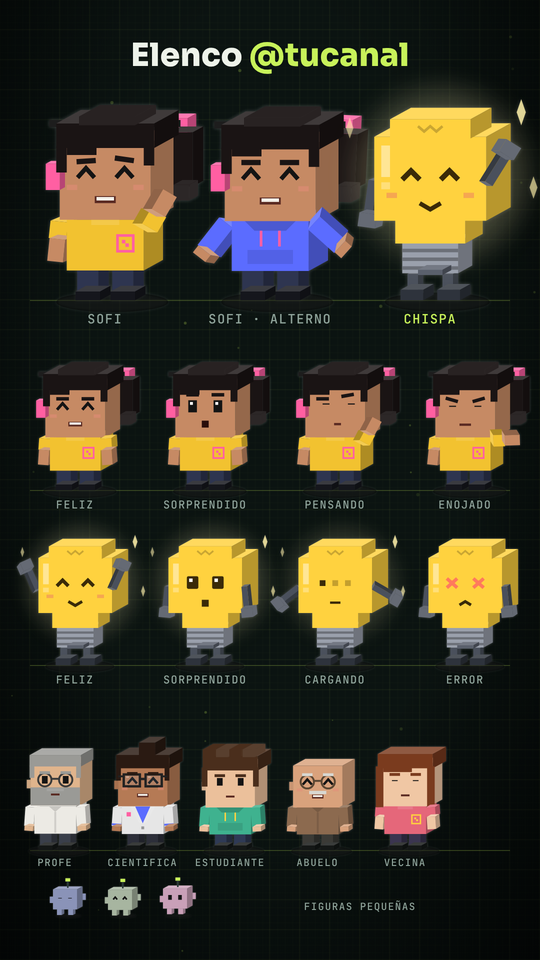

# Claude Skills · Shorts animados

Crea **shorts animados para TikTok y YouTube** con **tus propios personajes**, **tu línea editorial** y **voz en off**,
conversando con Claude. Escribes un tema y recibes el video listo para subir y los textos para publicarlo.
No necesitas programar.

<p align="center">
  
</p>

**▶ Tutorial paso a paso en YouTube:** [ver el tutorial](https://youtu.be/1xqbsVt29h0)
<!-- PENDIENTE: reemplazar el enlace de arriba por el del video tutorial -->

---

## ¿Qué es?

Dos **skills de Claude** y una plantilla de video que producen shorts verticales (1080×1920) para publicar en
**TikTok** y **YouTube Shorts** (también sirven para Instagram Reels y Facebook).

El mismo tema sale en **dos versiones**, porque cada plataforma premia algo distinto:

| | TikTok · versión ágil | YouTube · versión clase |
|---|---|---|
| Objetivo | que lo vean completo y comenten | que lo encuentren por búsqueda |
| Duración (por defecto) | 25–40 s | 35–55 s |
| Estilo | subtítulos grandes, cortes rápidos, aviso "+ Sígueme" | subtítulos medianos, transiciones suaves, capítulos "03/07" |
| Cierre | pregunta para comentarios | enlace a tu video relacionado |

Todo eso se puede cambiar en tu línea editorial.

**Escribes:**

```
/nuevo-video ambos por qué el cielo es azul
```

**Recibes:**

- La **trama** de cada versión en una tabla, para aprobarla o pedir cambios.
- El **guion para la voz** en texto plano.
- Los **textos para publicar**: descripción de TikTok, y título y descripción de YouTube, con tus hashtags.
- La **voz en off** generada con ElevenLabs (o tu propio audio).
- El **video final** de cada plataforma, con escenas y subtítulos sincronizados con la voz.

## Los dos skills

| Skill | Para qué |
|---|---|
| **`/personajes`** | Crea tu elenco: el **personaje principal** a partir de **tu foto** o de una descripción, un **personaje secundario** (robot, foco u otra persona) y extras. Te muestra una hoja con todos para aprobarla. |
| **`/nuevo-video`** | Crea cada video: trama, textos, voz y MP4. También configura tu **línea editorial** (`/nuevo-video editorial`) y tu **voz** (`/nuevo-video voz`). |

Viene con un **ejemplo listo**: Sofi (presentadora), Chispa (un foco con humor) y un canal ficticio de ciencia,
@tucanal. Cuando creas tus personajes y tu línea editorial, el ejemplo deja de usarse.

<p align="center">
  
</p>

## Requisitos

| Qué | Para qué | Notas |
|---|---|---|
| **App de escritorio de Claude** con **Claude Code** | Usar los skills | Claude Code está incluido en los planes **Pro** y **Max** ([ver planes](https://support.claude.com/en/articles/11145838)). |
| **Node.js 20 o superior** | Armar y exportar los videos | Descárgalo de [nodejs.org](https://nodejs.org) (versión LTS). |
| **ElevenLabs** (opcional) | Generar la voz en off con IA | Necesitas una clave de API. Con el plan gratuito algunas voces no están disponibles. Sin ElevenLabs puedes usar tu propio audio o exportar sin voz. |

> Yo lo uso con **Claude Pro** y el plan **Starter de ElevenLabs**.

## Instalación

### Opción A · Sin terminal

1. Instala **Node.js 20+** desde [nodejs.org](https://nodejs.org) (botón LTS → siguiente, siguiente).
2. En esta página: botón verde **Code → Download ZIP**. Descomprímelo donde quieras
   (se crea la carpeta `claude-skills-shorts-animados-main`).
3. Abre la app de **Claude** → pestaña **Code** → entorno **Local** → **Open folder…** → elige esa carpeta.
4. Escribe: `prepara el estudio`. Claude instala lo necesario (1–2 minutos la primera vez) y te dice qué falta configurar.
5. Escribe `/skills` y confirma que aparecen **`personajes`** y **`nuevo-video`**.

### Opción B · Con git

```bash
git clone https://github.com/miguelcotrinaia/claude-skills-shorts-animados.git
cd claude-skills-shorts-animados
npm install
```

Luego abre la carpeta en la app de Claude (pestaña **Code** → entorno **Local** → **Open folder…**).

## Primeros pasos

1. **Mira el ejemplo.** Pide *"abre el Studio"*: verás los videos de ejemplo `cielo-azul-tiktok` y `cielo-azul-youtube`.
2. **Crea tus personajes.**
   ```
   /personajes
   ```
   Adjunta tu foto (o descríbete), elige tu personaje secundario y aprueba la hoja del elenco.
3. **Define tu línea editorial.**
   ```
   /nuevo-video editorial
   ```
   Claude te muestra el ejemplo y te hace 5–6 preguntas: de qué trata tu canal, para quién, tono, idioma, duración
   por plataforma, @usuario, hashtag y colores.
4. **Crea tu primer video.**
   ```
   /nuevo-video ambos <tu tema>
   ```

> Si pides un video sin haber creado tus personajes o tu línea editorial, Claude te lo pregunta en ese momento.

## Cómo se crea un video

1. **Trama.** Claude propone el guion de cada plataforma en una tabla: escena, tipo, título y lo que se dice.
   Responde **"aprobado"** o pide cambios (*"la escena 2 más corta"*, *"más humor"*).
2. **Textos.** Te entrega, listos para copiar, el guion para la voz y los textos para publicar.
   También quedan en la carpeta `out/`.
3. **Voz en off.** Antes de generar te confirma la voz y cuántos créditos usará (ver abajo).
4. **Video.** Exporta `out/<id>.mp4` por cada plataforma.
5. **Publica.** Sube el MP4 con sus textos. En YouTube Studio (computadora) agrega al Short el **Video relacionado**.

Ejemplos:

```
/nuevo-video tiktok cómo ahorrar agua en casa
/nuevo-video youtube qué es la inflación
/nuevo-video ambos por qué el cielo es azul
```

## La voz en off

Una sola voz narra todo el video. Los personajes mueven la boca cuando "hablan", pero la voz es la misma. Tienes tres opciones:

1. **ElevenLabs con tu cuenta (por defecto).**
   - En [elevenlabs.io](https://elevenlabs.io) → **Developers → API Keys** → crea una clave con permiso **Text to Speech**
     (y, para ver tus créditos y el nombre de la voz, **Voices: Read** y **User: Read**).
   - Abre el archivo **`.env`** de la carpeta y pega la clave después de `ELEVENLABS_API_KEY=`. Guarda.
   - **No pegues la clave en el chat.** Queda solo en tu computadora.
2. **Tu propio audio.** Graba (o genera en otra app) leyendo el guion, guárdalo como `public/audio/<id>.mp3`
   y dile a Claude *"ya dejé mi audio de <id>"*. Lo sincroniza con el video.
3. **Sin voz.** El video sale igual, como vista previa; le pones la voz después.

La voz por defecto está en `config/voz.json`. Si no está disponible en tu cuenta, Claude te muestra tus voces para
que elijas una (`/nuevo-video voz`).

## Qué puedes personalizar

| Qué | Cómo |
|---|---|
| Tus personajes: aspecto, nombres, papel y personalidad | `/personajes editar <cambio>` |
| Extras para escenas de grupo | `/personajes agregar <descripción>` · `/personajes quitar <nombre>` |
| Tema, público, tono, duración y estructura por plataforma | `/nuevo-video editorial <cambio>` |
| @usuario, lema de la serie, redes, hashtags y colores | `/nuevo-video editorial <cambio>` |
| Estilo de cada plataforma (`agil` o `clase`) | `/nuevo-video editorial <cambio>` |
| Voz por defecto | `/nuevo-video voz` |
| Volver al ejemplo | `/personajes reiniciar` · `npm run perfiles -- --restaurar todo` |

Ejemplos: *"ponle lentes redondos a mi personaje"*, *"más humor en TikTok"*, *"que los de YouTube duren 60 segundos"*.

## Problemas frecuentes

| Pasa esto | Haz esto |
|---|---|
| No aparecen `/personajes` ni `/nuevo-video` | Revisa que abriste la carpeta del proyecto (la que tiene `package.json`), no una carpeta de más arriba. |
| `node` no se reconoce | Instala Node.js 20+ y vuelve a abrir la app de Claude. |
| `SIN_CLAVE · Falta tu clave de ElevenLabs` | Pega tu clave en `.env`, o usa tu propio audio, o exporta sin voz. |
| "No encontré esa voz en tu cuenta" | La voz por defecto no está en tu cuenta: `/nuevo-video voz` y elige una tuya. |
| El video se detiene con "voz sin sincronizar" | Pide *"sincroniza la voz de <id>"* y vuelve a exportar. |
| Los subtítulos tienen una palabra mal escrita | Pide el cambio a Claude; corrige el texto sin rehacer la voz. |

## Dónde queda todo

| Carpeta / archivo | Qué es |
|---|---|
| `perfiles/` | Tus personajes, tu canal y tu línea editorial |
| `out/` | Videos (`.mp4`), guiones de voz y textos para publicar |
| `public/audio/` | Las voces de cada video |
| `public/music/` | Música de fondo opcional |
| `src/videos/` | Un archivo por video (lo escribe Claude) |
| `plantillas/ejemplo/` | El ejemplo original, para restaurarlo |
| `.claude/skills/` | Los dos skills |
| `.env` | Tu clave de ElevenLabs (no se sube a GitHub) |

<details>
<summary><b>Comandos de terminal (opcional)</b></summary>

```bash
npm run estado                 # qué falta configurar
npm run dev                    # abre el Studio en el navegador
npm run personajes             # hoja del elenco → out/personajes.png
npm run perfiles               # valida los perfiles
npm run guion -- <id>          # guion de voz en texto plano
npm run voces -- --info        # voz por defecto y créditos
npm run voz:ia -- <id>         # voz con ElevenLabs
npm run sincronizar -- <id>    # sincroniza tu propio audio
npm run render -- <id>         # exporta out/<id>.mp4
```

</details>

## Créditos y licencia

- Los videos se arman con [Remotion](https://www.remotion.dev). Remotion es gratis para personas y empresas pequeñas;
  las empresas más grandes necesitan licencia de empresa. Revisa las condiciones en
  [remotion.pro/license](https://www.remotion.pro/license) antes de usarlo con fines comerciales a nombre de una empresa.
- La voz con IA usa la API de [ElevenLabs](https://elevenlabs.io) con tu propia cuenta.
<!-- PENDIENTE: licencia de este repositorio -->

## Autor

Creado por **Miguel Cotrina**, arquitecto de soluciones de IA.

Si te sirvió, sígueme como **@miguelcotrinaia** en todas las redes:

[LinkedIn](https://www.linkedin.com/in/miguelcotrinaia) ·
[YouTube](https://www.youtube.com/@miguelcotrinaia) ·
[TikTok](https://www.tiktok.com/@miguelcotrinaia) ·
[Instagram](https://www.instagram.com/miguelcotrinaia) ·
[Facebook](https://www.facebook.com/miguelcotrinaia)
